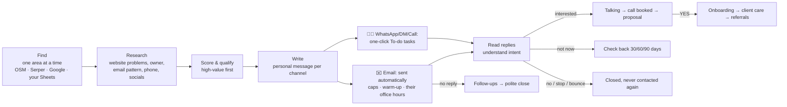

# 🪐 Orbit

*by [Indrix](https://nandaniramoliya.github.io/Indrix/) · repository: LeadAutomationPipeline*

**Orbit is a 24/7 sales machine for freelancers and agencies.** It finds businesses that need your service (one city at a
time, then the whole world), researches each one, finds the owner and every way to reach them, writes a personal
message, sends emails at human speed, puts WhatsApp / Instagram / LinkedIn / X / Facebook messages and phone calls
on your To-do as one-click tasks, reads the replies, answers them, and runs a **different follow-up track for every
outcome**, until the lead becomes a client or is closed politely.

You spend 15–30 minutes a day on one page (**To-do**). Everything else runs by itself, in the background, 24/7.

> Built from four playbooks (Sellbird setup kit, *4 AI Employees*, *The Cold Email Hack Playbook*, *The Client
> Onboarding System*), the best ideas of [Sellbird](https://github.com/ethanplusai/sellbird) re-implemented here
> (email-pattern finding, more buying signals, signal-based target lists, isolated Claude CLI), and freelance sales practice.

---

## How it works



| | |
|---|---|
| **Reach** | Start city → your next areas → the rest of your country → the world, city by city, each in its own timezone. Big cities are searched piece by piece so nobody is missed. |
| **Channels** | ✉️ email (automatic) · 💬 WhatsApp (opens with the message typed) · 📸 Instagram · 💼 LinkedIn · 𝕏 X · 📘 Facebook · 📞 calls with a personalised script |
| **Research** | 22 buying signals with evidence: no website, no online booking, not mobile-friendly, slow, "Not secure", outdated, DIY builder, agency-built, running ads, hiring (job boards), low rating, few reviews, startup/funded… |
| **Follow-ups** | Separate tracks for: no reply, no email, interested, call booked, deciding, not now, client onboarding, client care |
| **Safety** | Test mode by default · nothing sent without your OK (until autopilot) · spam/AI-phrase checks · daily caps + warm-up · opt-outs honoured on every channel · one-click pause |
| **24/7** | `leadpipe service install`: starts with your computer, hidden, keeps it awake, restarts itself (Windows, Mac, Linux), or Docker / a $5 cloud server |
| **Scale** | Several sending mailboxes, each with its own warm-up and limit |

## Quick start

```bash
git clone https://github.com/NandaniRamoliya/LeadAutomationPipeline.git
cd LeadAutomationPipeline
python -m venv .venv
.venv\Scripts\activate            # Mac/Linux: source .venv/bin/activate
pip install -e .
```

```bash
leadpipe demo                                  # explore a safe demo first
leadpipe -c demo/config.yaml dashboard         # http://localhost:8787
```

Your own setup:

```bash
leadpipe start                 # opens the system; go to http://localhost:8787 → Settings → Setup
leadpipe doctor                # checks mailbox, SPF/DKIM/DMARC, settings
leadpipe service install       # run 24/7 in the background from now on
```

**Read the [User Guide](docs/USER_GUIDE.md)**: it explains every page, every follow-up path, channels, going live,
running 24/7, importing your Google Sheets, and troubleshooting.

## The dashboard (5 pages)

| Home | To-do | Leads | Clients | Settings |
|---|---|---|---|---|
| running? pause · today · which city now/next | everything that needs you, one button each | every business, why it's good, what happens next | onboarding progress | setup form, areas, 24/7, import, do-not-contact, statistics |

## Documentation

| Document | For |
|---|---|
| [docs/USER_GUIDE.md](docs/USER_GUIDE.md) · **[PDF](docs/pdf/Orbit-User-Guide.pdf)** | Everything to set up, run and use it |
| [docs/DEVELOPER_GUIDE.md](docs/DEVELOPER_GUIDE.md) · **[PDF](docs/pdf/Orbit-Developer-Guide.pdf)** | Architecture, modules, data model, configuration, extending, testing, deployment |
| [docs/SALES_PLAYBOOK.md](docs/SALES_PLAYBOOK.md) | The sales rules it follows, call scripts, objections, pricing |
| [docs/LEGAL_AND_COMPLIANCE.md](docs/LEGAL_AND_COMPLIANCE.md) | Email, WhatsApp, DM and calling rules by country |
| [docs/templates/](docs/templates/) | Service agreement, proposal, welcome document, kickoff agenda, access checklist, client portal |
| [docs/ARCHITECTURE.md](docs/ARCHITECTURE.md) | Short architecture summary (details in the Developer Guide) |

## Project layout

```
leadpipe/
  engine.py         the 24/7 loop          service.py      background service (Win/Mac/Linux), keep-awake, logs
  discovery/        areas rollout, OSM, Serper, Google Places, CSV / Google Sheets import
  enrich/           website audit, email patterns, verification
  channels.py       email / WhatsApp / Instagram / LinkedIn / X / Facebook / call: availability + one-click links
  writer.py         AI or template messages per channel     templates.py  copy, call scripts, signals
  sender.py         SMTP / test-mode sender, caps, warm-up, office hours     mailboxes.py  several mailboxes
  inbox.py          IMAP reader            classifier.py   reply intent       handler.py  reply → stage → answer
  tasks.py          the To-do list, call outcomes, logged DM/phone replies
  pipeline.py       stages + follow-up tracks       onboarding.py  contract → … → portal
  dashboard/        web UI                 default_config.yaml  every setting, documented
tests/              unit + end-to-end tests (40)
```

## Tests

```bash
pip install -e ".[dev]"
pytest
```

---

*Outreach has its own laws (CAN-SPAM, GDPR, DPDP, CASL, TCPA, TRAI…). Read
[docs/LEGAL_AND_COMPLIANCE.md](docs/LEGAL_AND_COMPLIANCE.md). This project is not legal advice.*
