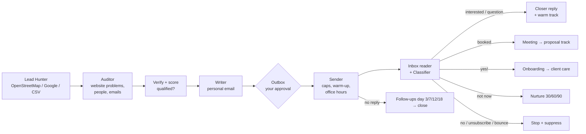

# LeadAutomationPipeline

**A 24/7 sales pipeline for freelancers and small agencies.** It finds businesses that need your service,
checks their website for real problems, finds the right person, writes a short personal email, sends it at
human speed, follows up, reads the replies, answers them, and then runs a **different follow-up track for every
outcome**:

- they're **interested**: get the call booked
- they **booked a call**: proposal follow-ups after it
- they **said yes**: client onboarding (contract → payment → welcome → kickoff → access → portal), then client care and referrals
- they said **"not now"**: check back in 30/60/90 days
- **no reply** after 5 emails: polite close
- they said **no / unsubscribe**: stop forever

You spend about 15 minutes a day approving emails and taking calls. The machine does the rest.

> Built from four playbooks (Sellbird setup kit, *4 AI Employees*, *The Cold Email Hack Playbook*, *The Client
> Onboarding System*) plus standard freelance sales practice. See [docs/SALES_PLAYBOOK.md](docs/SALES_PLAYBOOK.md).

---

## How it works



| Stage | What happens automatically |
|---|---|
| **cold** | Day 0 intro → day 3 bump → day 7 new insight → day 12 free quick-win offer → day 18 polite close → *lost* |
| **interested** | Closer reply drafted at once; if no call booked: day 2 booking link, day 5 proof, day 10 close the loop → *nurture* |
| **meeting** | Confirmation reply; the day after the call the **proposal** track starts |
| **proposal** | Day 2 "anything to change?", day 5 FAQ, day 10 smaller first step, day 21 close file → *nurture* |
| **won** | Contract → invoice → welcome doc + kickoff link → access list → portal link, with reminders when a step stalls |
| **client** | Day 14 check-in, day 30 testimonial, day 60 referral ask, day 120 next-project idea |
| **nurture** | Day 30, 60, 90 check-ins with a fresh idea → *lost* |
| **lost / unsubscribed / bounced** | Never emailed again |

## Safety first

- **Nothing is sent without your OK** (autopilot is off until *you* turn it on).
- Starts in **dry-run** mode: emails are saved as `.eml` files until you switch to real sending.
- Every email is checked for spammy phrases, unfilled `[Name]` tags, prices in a first email, too many links, misleading `Re:`
  subjects, length, and the do-not-contact list.
- Daily cap with **warm-up ramp**, recipient **office hours**, **random gaps** between sends, **one company per day**, max
  2 people per company, and **stop the whole company when anyone replies**.
- Every email has a signature, your postal address and an easy opt-out. Unsubscribes and bounces are handled instantly.
- One button / command pauses everything: `leadpipe sending pause`.

## Quick start (10 minutes)

```bash
git clone https://github.com/NandaniRamoliya/LeadAutomationPipeline.git
cd LeadAutomationPipeline
python3 -m venv .venv && source .venv/bin/activate      # Windows: .venv\Scripts\activate
pip install -e .
```

```bash
leadpipe demo                                    # explore a safe demo first (made-up leads)
leadpipe -c demo/config.yaml dashboard           # open http://localhost:8787
```

Then set up your own:

```bash
leadpipe init          # asks a few questions, creates config.yaml + .env
leadpipe doctor        # checks mailbox, SPF/DKIM/DMARC, AI, settings
leadpipe start         # runs 24/7: engine + dashboard at http://localhost:8787
```

**Read the full [User Guide](docs/USER_GUIDE.md)**: setup, daily routine, every setting, going live, running 24/7, troubleshooting.

## AI is optional

- With `ANTHROPIC_API_KEY` (or the `claude` CLI logged in to your Claude plan), Claude writes each email from the research,
  reads replies, and drafts answers. Every AI draft still passes the same safety checks, and falls back to templates if it doesn't.
- Without AI, hand-written templates are used, with several variants per step so no two emails look the same.

## Documentation

| Document | For |
|---|---|
| [docs/USER_GUIDE.md](docs/USER_GUIDE.md) | Everything you need to set up, run and use it |
| [docs/SALES_PLAYBOOK.md](docs/SALES_PLAYBOOK.md) | The sales rules the system follows, plus call scripts, objections and pricing |
| [docs/LEGAL_AND_COMPLIANCE.md](docs/LEGAL_AND_COMPLIANCE.md) | CAN-SPAM, GDPR, India DPDP, CASL and what the tool does for each |
| [docs/templates/](docs/templates/) | Service agreement, proposal, welcome document, kickoff agenda, access checklist, client portal |
| [docs/ARCHITECTURE.md](docs/ARCHITECTURE.md) | For developers: modules, data model, how to extend |

## Project layout

```
leadpipe/
  cli.py              all `leadpipe` commands
  engine.py           the 24/7 loop (replies → timers → send → write → research → discover)
  pipeline.py         stages + follow-up tracks (the state machine)
  discovery/          OpenStreetMap, Google Places, CSV import
  enrich/             website audit (signals, people, emails) + email verification
  writer.py           AI / template email writer
  templates.py        signals, email templates, Closer replies, onboarding emails
  compliance.py       pre-send checks + legal footer
  sender.py           SMTP / dry-run sender with caps, warm-up, office hours
  inbox.py            IMAP reader (read-only)
  classifier.py       reply intent detection
  handler.py          reply → stage → reply draft → alert
  onboarding.py       contract → payment → welcome → kickoff → access → portal
  analytics.py        reply rates by step, signal, category
  dashboard/          web UI (Flask)
  default_config.yaml every setting, documented
tests/                unit + end-to-end tests (pytest)
deploy/               systemd, Windows, Caddy (HTTPS) examples
```

## Tests

```bash
pip install -e ".[dev]"
pytest
```

---

*Cold email has its own laws (CAN-SPAM, GDPR, DPDP, CASL...). Read [docs/LEGAL_AND_COMPLIANCE.md](docs/LEGAL_AND_COMPLIANCE.md).
This project is not legal advice.*
